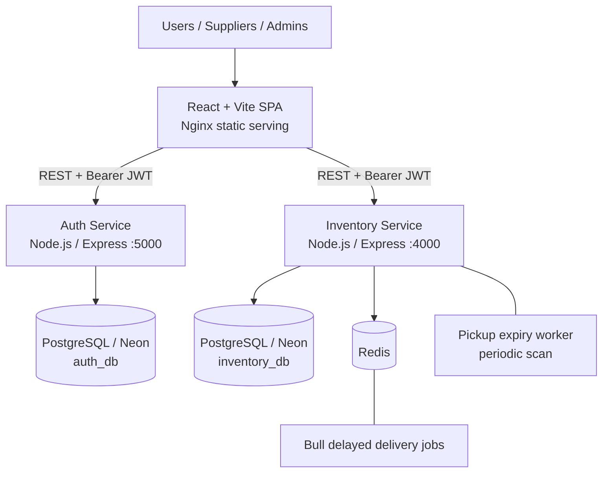
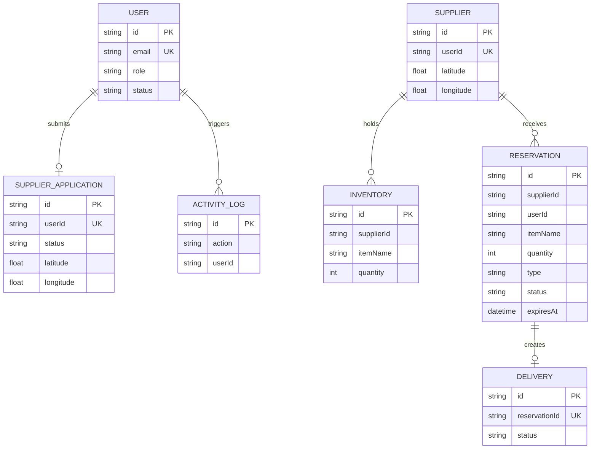
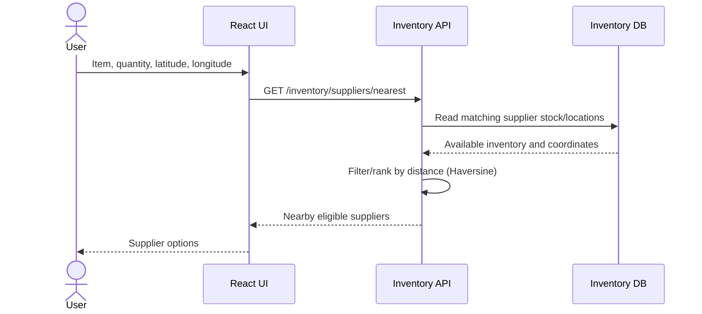
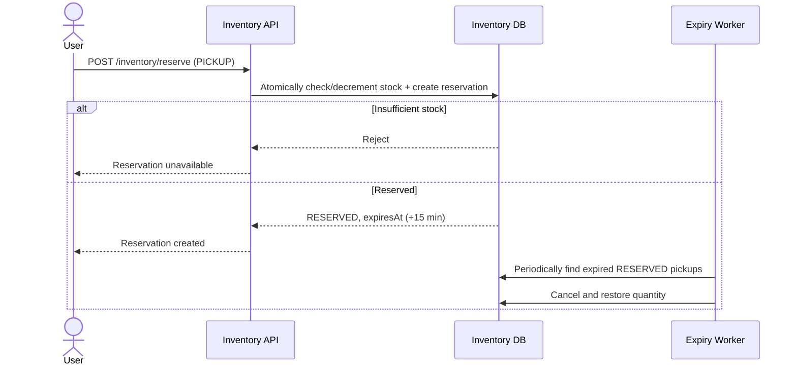
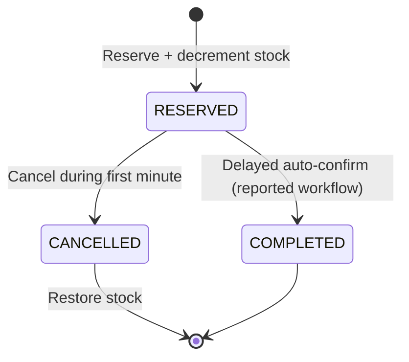
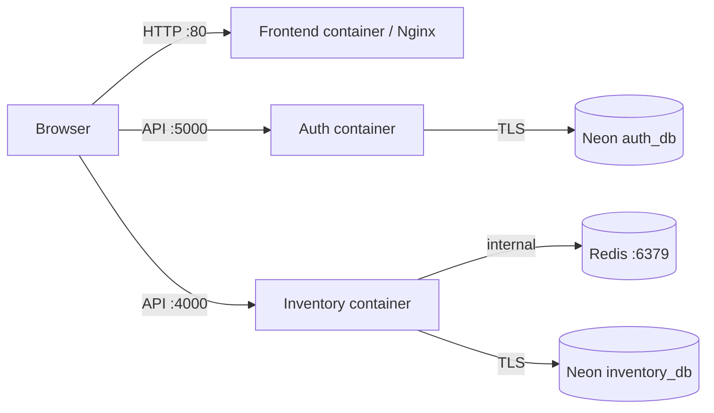
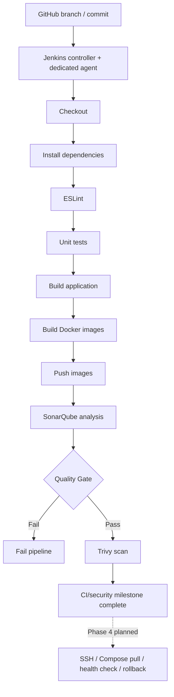

# RescueChain — Architecture & System Design

> **Documentation status (October 2026):** This document describes the application architecture and the reported implementation through DevOps Phase 3. Deployment automation, notifications, and the monitoring stack (Phases 4–6) are **planned**, not presented as operational. Some interface and configuration details must be checked against the current branch before relying on them as exact contracts.

[← Main README](README.md) · [Source repository](https://github.com/RudraSingh05/RescueChain)

## 1. System goals and scope

RescueChain is a microservices-oriented emergency-supply discovery and reservation platform. A user can search for nearby suppliers of oxygen, blood, or medicines, reserve available quantities for pickup or delivery, and view reservation history. Suppliers maintain inventory; administrators review supplier applications and manage accounts.

**Design goals:** fast geographical discovery, inventory consistency during concurrent reservations, time-bound reservation management, separation of service responsibilities, and repeatable CI/security validation.

**Important boundary:** This is a demonstration/learning platform, not a certified medical dispatch or emergency response system. No guarantee of physical delivery, real-time stock correctness across offline suppliers, or emergency-service availability is implied.

## 2. High-level component architecture



The diagram shows logical dependencies. It does **not** imply a deployed API gateway, Kubernetes cluster, WebSocket system, or production load balancer.

### Technology choices

| Concern | Implementation | Rationale |
| --- | --- | --- |
| Client | React, Vite, Zustand, Axios, CSS | Interactive role-specific interface and API access |
| Static frontend | Multi-stage Docker build + Nginx | Serve compiled assets without the Vite development server |
| APIs | Node.js, Express | Separate service ownership and REST interfaces |
| Persistence | PostgreSQL on Neon, Prisma | Relational constraints, transactions, migrations |
| Authentication | JWT, bcrypt, Zod, Helmet, CORS | Password hashing, validation, API hardening |
| Background work | Redis + Bull, periodic expiry worker | Delayed delivery transitions and timed pickup expiry |
| Delivery pipeline | Jenkins + Docker | Repeatable CI builds and image publishing |
| Quality/security | ESLint, unit tests, SonarQube quality gate, Trivy | Automated checks through Phase 3 |

## 3. Service boundaries and ownership

### Frontend

- React single-page application with user, supplier, and admin dashboards.
- Zustand stores authentication state; Axios attaches bearer tokens to authenticated requests.
- Protected/role routes improve UX, **but backend authorization remains authoritative**.
- Nginx serves the production build. Client-side JWT storage in `localStorage` is part of the current implementation and creates exposure to XSS; hardening should include a deliberate token-storage and CSP review.

### Auth service (`services/auth-service`, port 5000)

- Registration/login; password hashing and JWT issuance (reported token lifetime: one hour).
- User roles: `USER`, `SUPPLIER`, `ADMIN`; status: `ACTIVE`, `BLOCKED`.
- Supplier applications, admin approval/rejection, user administration, activity logging.
- Owns **auth_db**. Supplier identity/application state belongs here.

### Inventory service (`services/inventory-service`, port 4000)

- Supplier inventory CRUD and geographic supplier discovery.
- Atomic stock decrement and reservation creation.
- Pickup expiration/restocking and delayed delivery confirmation.
- Supplier reservations, user reservations, admin inventory views.
- Owns **inventory_db**. Stock and reservation state belong here.

**Cross-service consistency:** the inventory service stores user and supplier identifiers, but databases are separate. Referential integrity across the databases is not enforced by PostgreSQL foreign keys. Validate user/supplier permissions and blocked status at the service boundary; the exact cross-service verification mechanism should be confirmed from source.

## 4. Data model (logical view)



The ER diagram is **logical**: `USER` is stored in the auth database, while `SUPPLIER`, `INVENTORY`, `RESERVATION`, and `DELIVERY` are stored in the inventory database. It must not be read as an assertion that cross-database foreign keys exist.

Notable constraints: unique user email; one supplier application per user; unique `(supplierId, itemName)` inventory row; one delivery per reservation. Refer to each service's `prisma/schema.prisma` for authoritative types and relations.

## 5. Critical workflows

### A. Nearby supplier discovery



The discovery endpoint uses item name, requested quantity, and geographic coordinates. Distance is based on geographic proximity, not live traffic or road travel time.

### B. Pickup reservation



**Concurrency invariant:** available stock must never become negative, and the same expiry/cancellation must not restock more than once. Atomic decrement is implemented; verify that the current transaction and worker code enforce idempotent state transitions under simultaneous requests or multiple worker instances.

### C. Delivery reservation



A Bull delayed job implements the one-minute cancellation window and auto-confirmation. **Auto-confirmation is not proof of physical delivery.** The precise delivery status enum and transition implementation should be verified in the inventory service.

## 6. API boundaries (selected endpoints)

| Service | Method | Route | Responsibility |
| --- | --- | --- | --- |
| Inventory | `GET` | `/inventory/suppliers/nearest` | Nearby supplier search |
| Inventory | `POST` | `/inventory/reserve` | Create pickup/delivery reservation |
| Inventory | `GET` | `/inventory/my` | User reservations (check router context) |
| Inventory | `POST` | `/inventory/add` | Add supplier stock |
| Inventory | `PATCH` | `/inventory/update` | Update supplier stock |
| Inventory | `GET` | `/inventory/supplier/reservations` | Supplier reservation queue |

The supplier inventory view has also been described as `GET /inventory/my`; check route mounting to resolve the overlap. Authentication/admin endpoint paths are intentionally not guessed here. All sensitive operations must validate JWTs, roles, ownership, and account status on the backend.

## 7. Runtime and Docker topology



These ports reflect the reported local Compose configuration. Production network exposure, CORS origins, proxy paths, and TLS termination depend on the final deployment design. **Redis should remain on a private container network**, and neither database connection strings nor credentials belong in Git.

Repository infrastructure entry points:

```text
RescueChain/
├── README.md
├── ARCHITECTURE.md
├── Jenkinsfile
├── docker-compose.yml
├── docker-compose.prod.yml
├── frontend/
│   ├── Dockerfile
│   └── nginx.conf
├── services/
│   ├── auth-service/
│   └── inventory-service/
└── docker/
    └── jenkins/
        ├── docker-compose.yml
        └── agents/Dockerfile
```

## 8. CI and supply-chain security (Phases 0–3 complete)



This is a **conceptual stage sequence**, not a verbatim extraction from `Jenkinsfile`. The project reports Phases 0–3 complete; inspect pipeline code to confirm actual scan placement, failure thresholds, credential IDs, tagging policy, and which tests run.

| Phase | Status | Main scope |
| --- | --- | --- |
| 0: Production readiness | Complete (reported) | Multi-stage images, Nginx, health endpoints, Compose, lint/format |
| 1: Jenkins | Complete (reported) | Controller, agent, credentials, pipeline concepts |
| 2: CI | Complete (reported) | Checkout, install, lint, tests, build, Docker build/push |
| 3: Security | Complete (reported) | SonarQube, quality gate, Trivy |
| 4: Deployment | Planned | SSH, Compose pull, rolling restart, health checks, rollback |
| 5: Notifications | Planned | Slack/Discord build and deployment alerts |
| 6: Monitoring | Planned | Prometheus, Grafana, Node Exporter, cAdvisor, Loki, Promtail |

## 9. Reliability, security and trade-offs

- **Reservation contention:** conditional/atomic stock updates mitigate overselling; idempotent cancellation and worker locking require verification before multi-replica operation.
- **Queue availability:** delayed delivery transitions depend on Redis/Bull; define retry, reconciliation and dead-letter behavior before production use.
- **Periodic pickup expiry:** a 60-second scan means cleanup can occur after the nominal 15-minute deadline; the API should also enforce expiry at read/fulfillment time.
- **Separate databases:** improve ownership but complicate cross-service identity checks and consistency.
- **JWT and roles:** use server-side authorization and account status checks; frontend route guards are not a security boundary.
- **Secrets:** keep `.env`, Neon URLs, registry credentials and Jenkins agent secrets out of commits and build layers; use Jenkins credentials injection and scan Git history.
- **Public exposure:** avoid publishing Redis or databases directly; use TLS and least-privilege networks in eventual production deployment.
- **Emergency-use limitations:** supplier inventory can be stale; no SLA, verified courier integration, or regulatory compliance is claimed.


---

**Maintainer:** [RudraSingh05](https://github.com/RudraSingh05) · **[Back to README](README.md)**
